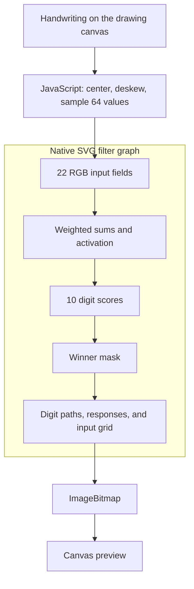

# Brain.svg

A neural network powered by SVG. Draw a digit and let the image recognize it. JavaScript is used only to prepare the input and display the output and inference is performed entirely by the browser's SVG filter engine.

[Demo](https://brain-svg.so1ve.dev)

## How it works

SVG filters process RGBA images through a graph of operations. Color channels carry numbers; filters can multiply, add, clamp, compare, and mask those numbers. These operations are enough to express this network's inference. The browser evaluates the graph while painting the SVG. [SVG filter specification](https://www.w3.org/TR/filter-effects-1/#FilterPrimitivesOverview)

A neuron needs a weighted sum and an activation:

```text
z = w0*x0 + w1*x1 + ... + bias
hidden = min(1, max(0, z))
```

Brain.svg stores the values in color channels and puts the learned coefficients in filter attributes. For example, a row of `feColorMatrix` computes `w0*R + w1*G + w2*B + bias`. Chaining these operations turns a color-processing graph into a neural network.



### 1. Build the SVG template

On page load, JavaScript reads the trained model and generates an SVG template containing the filter graph. Weights become matrix coefficients; biases become constant terms. Each intermediate image has a `result` name that later filters reference through `in` and `in2`, connecting the layers.

The SVG also contains paths for all ten display digits. The graph will decide which path becomes visible.

### 2. Encode handwriting as colors

After a stroke, JavaScript centers and deskews the handwriting, then samples it into an 8×8 grayscale image: 64 values between 0 and 1.

Every three values are packed into the red, green, and blue channels of a `feFlood`. For example, the first field carries pixels 0, 1, and 2. This produces 22 uniform 4×4 fields, with unused channels in the last field set to zero. These are small images carrying numeric inputs inside the filter graph.

For each recognition, JavaScript replaces the input colors in the SVG template. The weights, filter connections, and display paths stay unchanged. The resulting SVG is loaded as an image without inserting it into the visible page.

### 3. Compute the network layers

For each group of three neurons, `feColorMatrix` multiplies one input field by the corresponding weights. Its three output channels carry three partial sums. `feComposite operator="arithmetic"` then adds contributions from the remaining fields.

Color values are bounded, while weighted sums can be negative. The compiler therefore stores each partial sum as `128/255 + scale*z`, choosing a scale that leaves room for accumulation. Adding two encoded sums subtracts the extra `128/255` offset.

At the hidden layer, another matrix removes the scale and offset. Color clamping then implements `min(1, max(0, z))`, the activation used during training. Repeating the weighted-sum process produces ten output scores. These share one positive scale and offset so their ordering can be compared directly.

### 4. Select the winning digit

The ten scores are placed side by side as grayscale fields. A wide `feMorphology operator="dilate"` spreads the maximum value across the strip. Arithmetic subtraction and a discrete `feComponentTransfer` turn comparisons with that maximum into a binary mask, at the filter pipeline's color precision.

A second pass uses fixed priorities to resolve matching scores in favor of the lower digit. An input-ink mask suppresses the prediction when the drawing is empty.

### 5. Turn the mask into the visible result

The winning mask is transferred into the alpha channel. For each candidate, `feOffset` moves its digit path into the display position, `feTile` expands its mask, and `feComposite operator="in"` keeps only the visible parts. The winning path remains opaque; the other candidates become transparent.

Finally, `feMerge` combines the selected digit, score-intensity bars, winner marker, and enlarged input pixels. The scores are displayed as responses without a probability conversion.

### 6. Display the rendered pixels

The page loads the updated SVG into a detached image, waits for `image.decode()`, and requests an `ImageBitmap` with `createImageBitmap(image)`. The browser evaluates the SVG filters to produce the pixels.

## Network architecture

A fully connected network with **64 → 64 → 10** neurons and **4,810 parameters**:

- **64 inputs:** the pixels of the 8×8 image.
- **64 hidden neurons:** learned features of handwritten digits.
- **10 outputs:** one score for each digit from 0 to 9.

## Training data

The model is trained offline on two handwritten digit datasets:

- **[MNIST](https://yann.lecun.org/exdb/mnist/)** by Yann LeCun, Corinna Cortes, and Christopher J. C. Burges. Images are centered, deskewed, and downsampled to 8×8.
- **[UCI Optdigits](https://doi.org/10.24432/C50P49)** by E. Alpaydin and C. Kaynak (1998), licensed under [CC BY 4.0](https://creativecommons.org/licenses/by/4.0/). Its 8×8 pixel counts are normalized for training.

## LICENSE

[MIT](LICENSE)
